# 🛒 Mercado Express ✕ 🏦 Banco Tranquilo - Microsserviços com RabbitMQ

Integração de pagamentos entre o **Mercado Express** e a **API do Banco Tranquilo** usando **Spring Boot**, **RabbitMQ** (exchanges + queues de requisição e resposta), **PostgreSQL** e **envio de e-mail** de confirmação de pagamento, com **carrinho de compras** e **Dashboard da gerência** com gráficos de vendas, lucro e estoque.

Projeto do **Checkpoint 5 - Parte 2 (Microsserviços e Mensageria)** da disciplina **Java Advanced** - Tecnologia em Análise e Desenvolvimento de Sistemas (TDS) - FIAP.

> *"Quem ouve, esquece. Quem vê, lembra. Quem faz, aprende."*

💻 **IDE utilizada:** IntelliJ IDEA
🎥 **Vídeo de demonstração:** _inserir o link do YouTube (não listado)_

---

## 📑 Sumário

1. [Visão geral](#-visão-geral)
2. [Arquitetura](#️-arquitetura)
3. [Topologia RabbitMQ](#-topologia-rabbitmq-exchanges-e-queues)
4. [Fluxo de uma compra](#-fluxo-de-uma-compra)
5. [Spring Initializr e dependências](#-spring-initializr-e-dependências)
6. [Configuração do banco de dados (para o professor)](#️-configuração-do-banco-de-dados)
7. [Como executar](#️-como-executar)
8. [Telas](#️-telas)
9. [Testes: Postman, RabbitMQ Dashboard e script](#-testes)
10. [Envio de e-mail](#️-envio-de-e-mail)
11. [Estrutura do projeto](#-estrutura-do-projeto)
12. [Autores](#-autores)

---

## 📌 Visão geral

| Microsserviço | Porta | Responsabilidade |
|---|---|---|
| **mercado-express-loja** | `8081` | Catálogo, **carrinho**, finalização da compra, publicação da solicitação de pagamento, consumo da resposta do banco, baixa de estoque, **envio e registro de e-mails** e **Dashboard da gerência** |
| **banco-tranquilo-api** | `8082` | API do **Banco Tranquilo**: consome as solicitações de pagamento, valida conta/CPF/saldo, debita o valor, registra a transação e publica a resposta |

| Infraestrutura | Porta | Uso |
|---|---|---|
| **RabbitMQ** (+ Management) | `5672` / `15672` | Broker de mensagens e Dashboard |
| **PostgreSQL 16** | `5432` | Banco `mercadoexpress` (Loja - o mesmo da Parte 1) e `bancotranquilo` (Banco) |
| **Mailpit** | `1025` / `8025` | Servidor SMTP de testes + caixa de entrada web |

> A Loja usa a **mesma tabela de produtos da Parte 1** (`TDS_Sec_MVC_TB_Mercado`) no mesmo PostgreSQL: o que o ADMIN cadastra na Parte 1 aparece no catálogo da Parte 2.

---

## 🏗️ Arquitetura

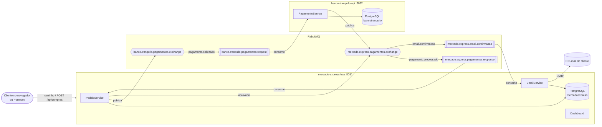

---

## 🐇 Topologia RabbitMQ (exchanges e queues)

Tudo é declarado automaticamente pelas classes `RabbitConfig` de cada serviço (o `RabbitAdmin` cria no broker ao conectar). As mensagens trafegam em **JSON** (`JacksonJsonMessageConverter`).

### Exchanges

| Exchange | Tipo | Quem publica | Para quê |
|---|---|---|---|
| `banco.tranquilo.pagamentos.exchange` | topic | Loja | Solicitações de pagamento |
| `mercado.express.pagamentos.exchange` | topic | Banco e Loja | Respostas de pagamento e pedidos de e-mail |
| `banco.tranquilo.dlx` | direct | broker | Dead letter das requisições |
| `mercado.express.dlx` | direct | broker | Dead letter das respostas e e-mails |

### Queues e bindings

| Fila | Exchange | Routing key | Consumidor |
|---|---|---|---|
| `banco.tranquilo.pagamentos.request` | `banco.tranquilo.pagamentos.exchange` | `pagamento.solicitado` | Banco Tranquilo |
| `mercado.express.pagamentos.response` | `mercado.express.pagamentos.exchange` | `pagamento.processado` | Loja |
| `mercado.express.email.confirmacao` | `mercado.express.pagamentos.exchange` | `email.confirmacao` | Loja (EmailService) |
| `banco.tranquilo.pagamentos.request.dlq` | `banco.tranquilo.dlx` | - | (mensagens com falha) |
| `mercado.express.pagamentos.response.dlq` | `mercado.express.dlx` | - | (mensagens com falha) |
| `mercado.express.email.confirmacao.dlq` | `mercado.express.dlx` | - | (mensagens com falha) |

**Confiabilidade:**
- filas **duráveis** e **retry** automático (3 novas tentativas, 2 s de intervalo); depois disso a mensagem vai para a **DLQ**;
- a Loja só publica **depois do commit** no PostgreSQL (`@TransactionalEventListener(AFTER_COMMIT)`), então o banco nunca responde sobre um pedido inexistente;
- **idempotência**: o banco não cobra duas vezes o mesmo `pedidoId`, e a Loja ignora respostas repetidas e não envia o mesmo e-mail duas vezes;
- `correlationId = pedido-{id}` em todas as mensagens.

### Mensagem de requisição (Loja → Banco)

```json
{
  "pedidoId": 1,
  "numeroConta": "1001-0",
  "cpf": "11111111111",
  "nomeCliente": "Maria Gabriela Landim Severo",
  "emailCliente": "gabi@email.com",
  "valor": 22.59,
  "descricao": "Compra Mercado Express - Pedido #1",
  "solicitadoEm": "2026-10-14T10:30:00"
}
```

### Mensagem de resposta (Banco → Loja)

```json
{
  "pedidoId": 1,
  "codigoTransacao": "BT-7F3A9C21",
  "status": "APROVADO",
  "mensagem": "Pagamento aprovado pelo Banco Tranquilo.",
  "valor": 22.59,
  "processadoEm": "2026-10-14T10:30:01.512"
}
```

---

## 🔄 Fluxo de uma compra

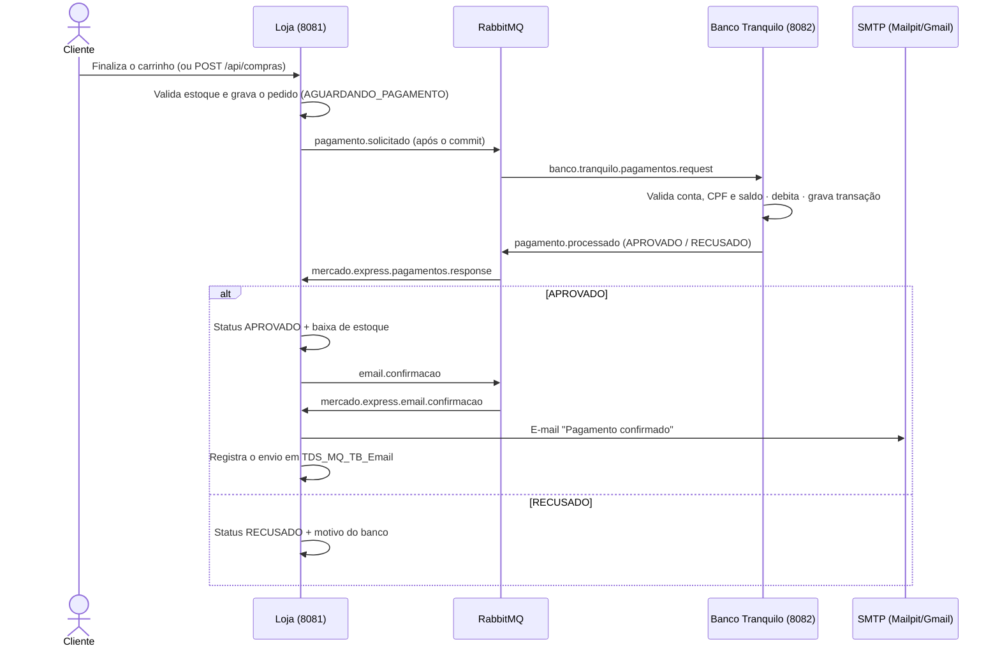

**Regras do Banco Tranquilo:** a conta precisa existir e estar ativa, o CPF precisa ser o do titular, o valor precisa ser positivo e o saldo suficiente.

**Contas de teste:**

| Conta | Titular | CPF | Saldo | Resultado esperado |
|---|---|---|---|---|
| `1001-0` | Maria Gabriela Landim Severo | 111.111.111-11 | R$ 5.000 | ✅ Aprovado |
| `1002-0` | Samara Porto Souza | 222.222.222-22 | R$ 10.000 | ✅ Aprovado |
| `2001-0` | Cliente Sem Saldo | 333.333.333-33 | R$ 20 | ❌ Saldo insuficiente |
| `3001-0` | Cliente Conta Bloqueada | 444.444.444-44 | R$ 1.000 | ❌ Conta bloqueada |

---

## 🧩 Spring Initializr e dependências

Os dois microsserviços foram criados no [Spring Initializr](https://start.spring.io) (Maven · Java 21 · Spring Boot 4.1.1 · Jar · YAML · Group `br.com.fiap`).

| Dependência | Loja | Banco | Para que serve |
|---|:-:|:-:|---|
| Spring Web | ✅ | ✅ | API REST e telas |
| Spring for RabbitMQ (AMQP) | ✅ | ✅ | Publicação/consumo de mensagens, exchanges e queues |
| Spring Data JPA | ✅ | ✅ | Persistência |
| PostgreSQL Driver | ✅ | ✅ | Banco de dados |
| Validation | ✅ | ✅ | Validação das requisições |
| Lombok | ✅ | ✅ | Menos código repetitivo |
| Spring Boot DevTools | ✅ | ✅ | Reload em desenvolvimento |
| Thymeleaf | ✅ | | Telas (carrinho, pedidos, dashboard) e template do e-mail |
| Java Mail Sender | ✅ | | Envio do e-mail de confirmação |

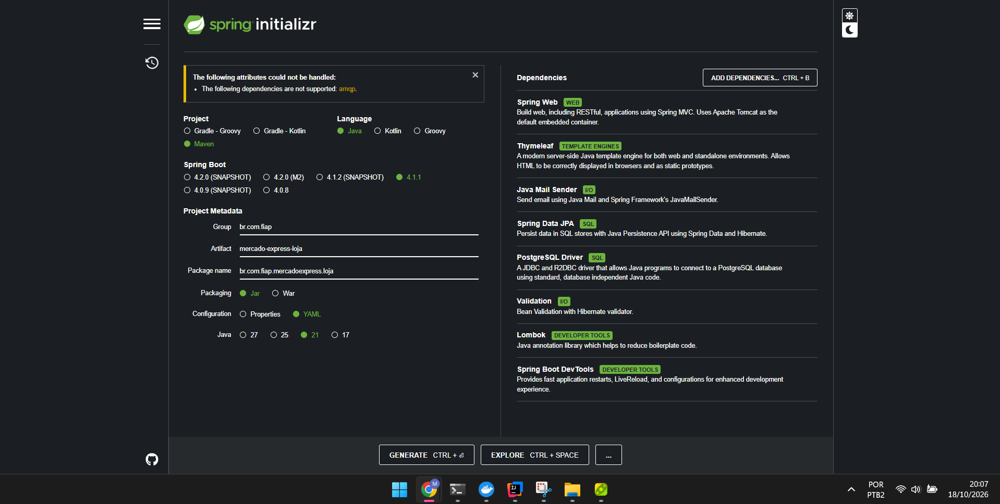
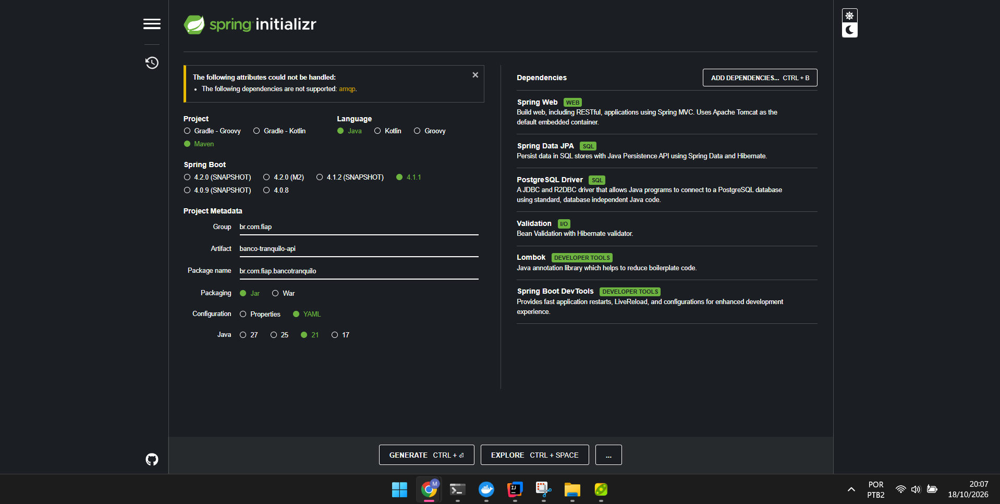

---

## 🗄️ Configuração do banco de dados

> Informações de configuração do BD para o professor de Java Advanced.

**SGBD:** PostgreSQL 16 (container `mx-postgres` do `docker-compose.yml`)

| Item | Valor |
|---|---|
| Host / porta | `localhost:5432` |
| Usuário / senha | `postgres` / `postgres` |
| Banco da Loja (mesmo da Parte 1) | `mercadoexpress` |
| Banco do Banco Tranquilo | `bancotranquilo` (criado por `docker/postgres/01-create-databases.sql`) |
| Criação das tabelas | automática (`spring.jpa.hibernate.ddl-auto: update`) |

**`mercado-express-loja/src/main/resources/application.yml`**

```yaml
spring:
  datasource:
    url: ${DB_URL:jdbc:postgresql://${DB_HOST:localhost}:${DB_PORT:5432}/${DB_NAME:mercadoexpress}}
    username: ${DB_USER:postgres}
    password: ${DB_PASSWORD:postgres}
    driver-class-name: org.postgresql.Driver
  jpa:
    hibernate:
      ddl-auto: update
```

**`banco-tranquilo-api/src/main/resources/application.yml`** - igual, com `DB_NAME` padrão `bancotranquilo`.

### Tabelas

| Banco | Tabela | Conteúdo |
|---|---|---|
| mercadoexpress | `tds_sec_mvc_tb_mercado` | Produtos (compartilhada com a Parte 1): nome, tipo, setor, tamanho, preço, custo, estoque |
| mercadoexpress | `tds_mq_tb_pedido` | Compras: cliente, conta, total, custo, status, código da transação, mensagem do banco, datas |
| mercadoexpress | `tds_mq_tb_item_pedido` | Itens de cada compra (produto, quantidade, preço e custo unitário) |
| mercadoexpress | `tds_mq_tb_email` | **Controle de e-mails**: pedido, destinatário, assunto, corpo HTML, status (ENVIADO/FALHA), erro, data |
| bancotranquilo | `tds_bt_tb_conta` | Contas: número, titular, CPF, saldo, ativa |
| bancotranquilo | `tds_bt_tb_transacao` | Transações: código, pedido, conta, valor, status, motivo, saldo após, data |

Consultas úteis:

```sql
-- banco mercadoexpress
SELECT id, cliente_nome, valor_total, status, codigo_transacao FROM tds_mq_tb_pedido ORDER BY id DESC;
SELECT pedido_id, destinatario, status, enviado_em FROM tds_mq_tb_email ORDER BY id DESC;
-- banco bancotranquilo
SELECT numero_conta, titular, saldo, ativa FROM tds_bt_tb_conta;
SELECT codigo, pedido_id, valor, status, mensagem FROM tds_bt_tb_transacao ORDER BY id DESC;
```

### Variáveis de ambiente (opcionais)

| Variável | Padrão | Serviço |
|---|---|---|
| `DB_HOST`, `DB_PORT`, `DB_NAME`, `DB_USER`, `DB_PASSWORD`, `DB_URL` | localhost, 5432, mercadoexpress/bancotranquilo, postgres, postgres | ambos |
| `RABBITMQ_HOST`, `RABBITMQ_PORT`, `RABBITMQ_USER`, `RABBITMQ_PASSWORD`, `RABBITMQ_VHOST`, `RABBITMQ_SSL` | localhost, 5672, guest, guest, /, false | ambos |
| `MAIL_HOST`, `MAIL_PORT`, `MAIL_USERNAME`, `MAIL_PASSWORD`, `MAIL_SMTP_AUTH`, `MAIL_STARTTLS`, `MAIL_FROM` | localhost, 1025, -, -, false, false | Loja |
| `BANCO_DELAY_MS` | 1500 (tempo simulado de processamento) | Banco |

> **LavinMQ / CloudAMQP:** basta trocar `RABBITMQ_HOST`, `RABBITMQ_USER`, `RABBITMQ_PASSWORD`, `RABBITMQ_VHOST`, `RABBITMQ_PORT=5671` e `RABBITMQ_SSL=true` com os dados da instância.

---

## ▶️ Como executar

**Pré-requisitos:** Java 21, Docker Desktop e IntelliJ IDEA.

```bash
# 1. Infraestrutura: PostgreSQL + RabbitMQ + Mailpit
docker compose up -d

# 2. Banco Tranquilo (terminal 1)
cd banco-tranquilo-api
./mvnw spring-boot:run

# 3. Loja Mercado Express (terminal 2)
cd mercado-express-loja
./mvnw spring-boot:run
```

> No IntelliJ: abra cada pasta (`banco-tranquilo-api` e `mercado-express-loja`) como projeto Maven e rode as classes `BancoTranquiloApiApplication` e `MercadoExpressLojaApplication`.
> Se o PostgreSQL da Parte 1 estiver rodando na porta 5432, pare-o antes (`docker compose down` na pasta da Parte 1) - este compose já cria o banco `mercadoexpress`.

**Tudo em Docker (opcional):** `docker compose --profile apps up -d --build`

| Endereço | O que é |
|---|---|
| http://localhost:8081 | Loja (catálogo e carrinho) |
| http://localhost:8081/dashboard | 📊 Dashboard da gerência |
| http://localhost:8082 | API do Banco Tranquilo |
| http://localhost:15672 | RabbitMQ Dashboard (`guest` / `guest`) |
| http://localhost:8025 | Caixa de entrada do Mailpit |

---

## 🖥️ Telas

> 📸 Os prints ficam na pasta [`docs/img`](docs/img).

### Loja - catálogo (`/loja`)
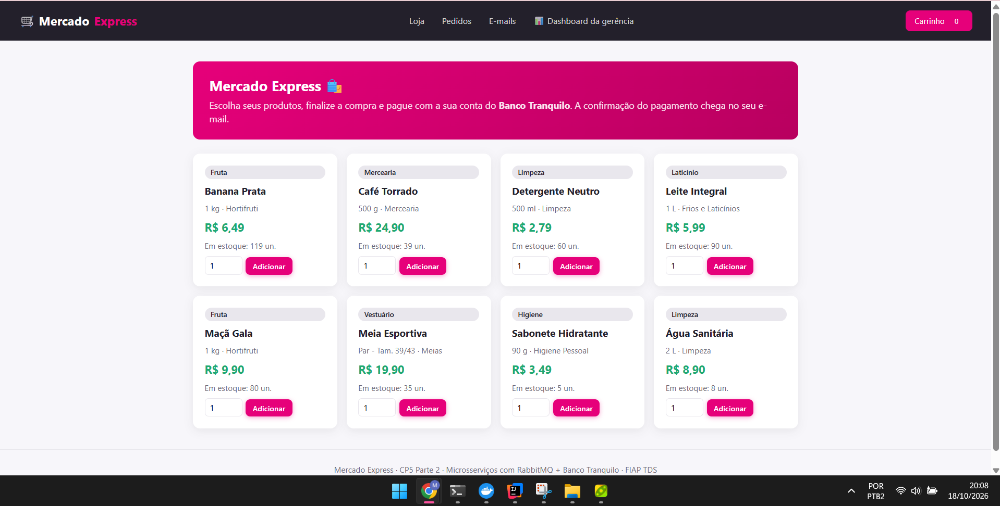

### Carrinho e finalização (`/carrinho`)
Mostra os produtos, permite alterar quantidades e pede nome, e-mail, CPF e conta do Banco Tranquilo. Ao clicar em **Pagar com Banco Tranquilo**, a API de integração de pagamentos é executada.
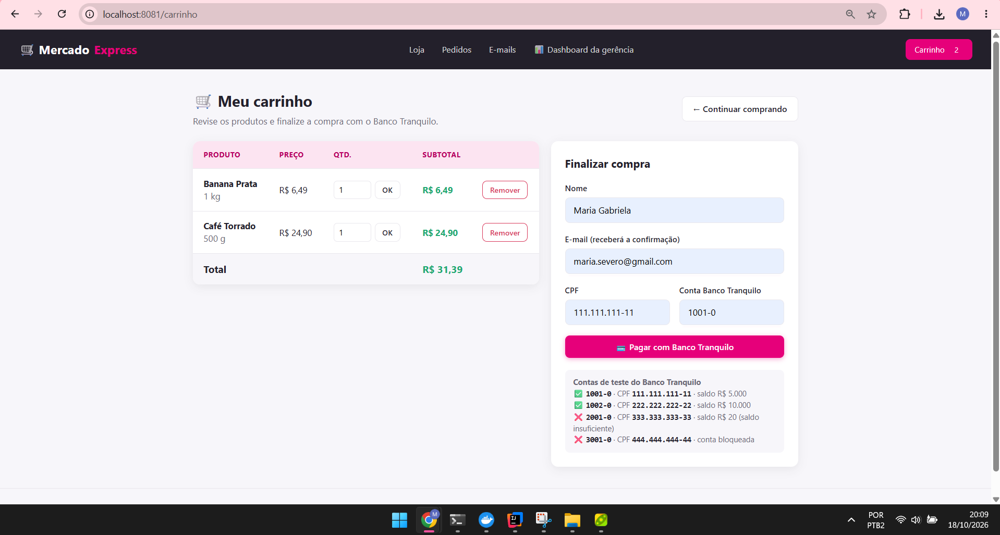

### Acompanhamento do pedido (`/pedidos/{id}`)
Atualiza sozinho a cada 2 s enquanto aguarda o banco e mostra a linha do tempo: pedido criado → solicitação publicada → resposta do banco → e-mail enviado.
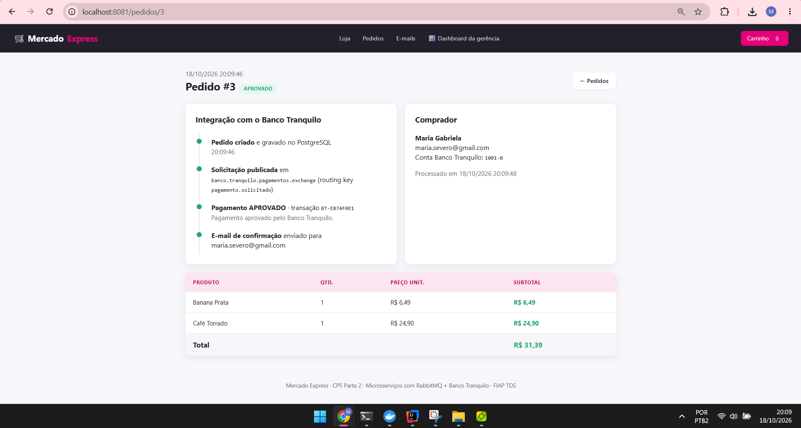
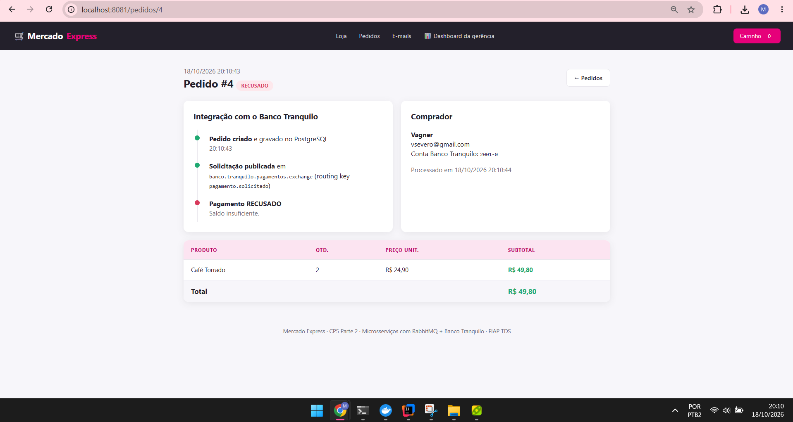

### E-mail de confirmação (Mailpit)
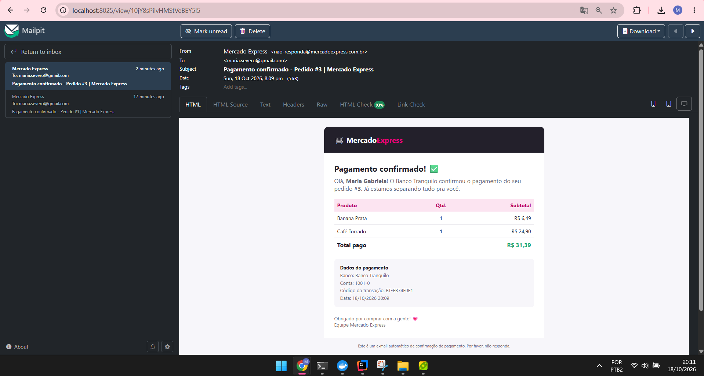

### Controle de e-mails (`/emails`)
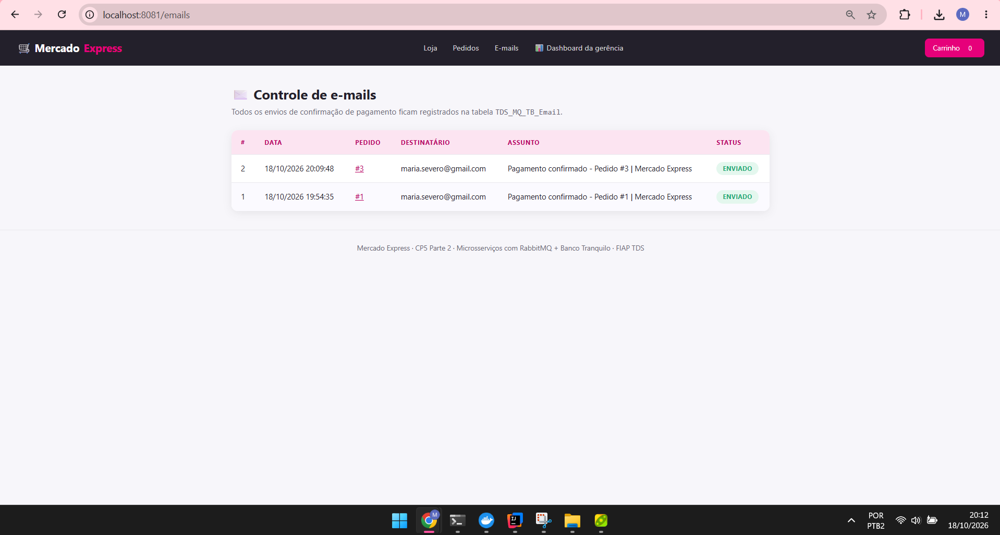

### Dashboard da gerência (`/dashboard`)
Faturamento, lucro, ticket médio, taxa de aprovação, e-mails enviados, valor em estoque e gráficos de **vendas por dia**, **lucro por dia**, **status dos pedidos**, **top produtos**, **faturamento por categoria** e **estoque por produto** (Chart.js), além das últimas compras e e-mails.
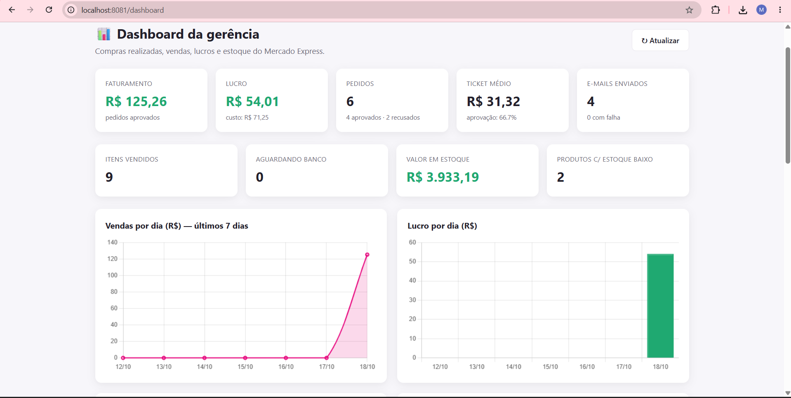
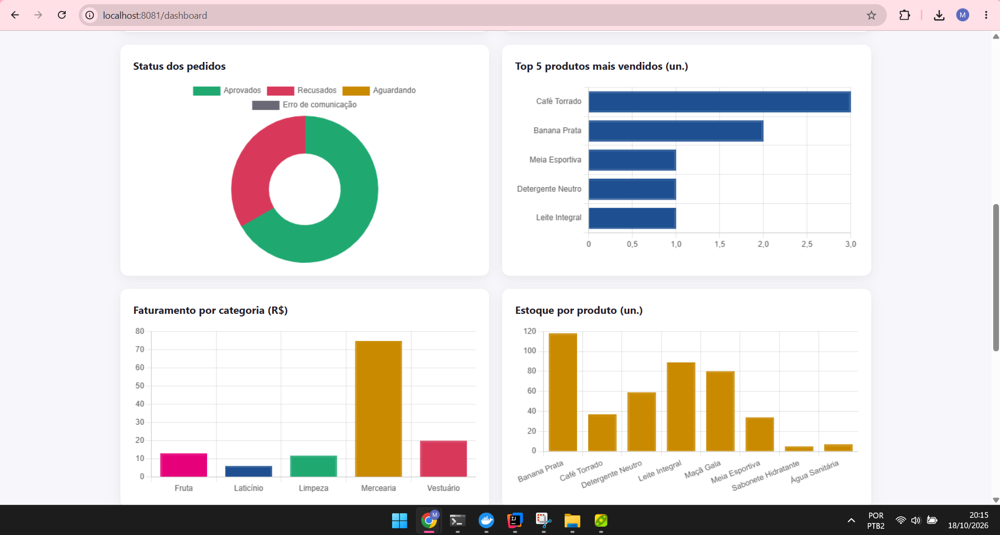
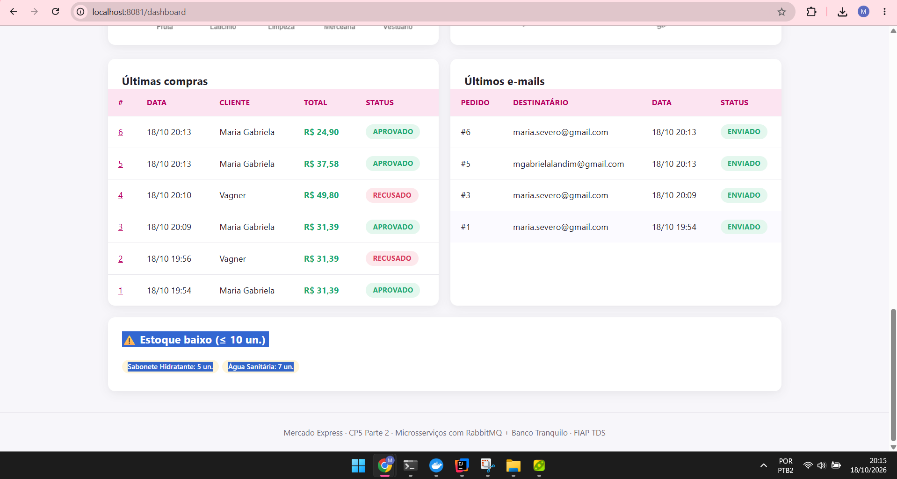

---

## 🧪 Testes

### 1) Postman / Insomnia

Importe [`postman/CP5-MercadoExpress-BancoTranquilo.postman_collection.json`](postman/CP5-MercadoExpress-BancoTranquilo.postman_collection.json). A coleção tem 3 pastas, com testes automáticos (`pm.test`):

| Pasta | Requisições |
|---|---|
| **Mercado Express (Loja)** | produtos · compra aprovada · status da compra · e-mails da compra · compras recusadas (saldo, conta bloqueada, CPF) · validação 400 · listar compras · e-mails · dashboard |
| **Banco Tranquilo API** | info · contas · conta · extrato · abrir conta · depósito · desbloquear · pagamento direto · transações |
| **RabbitMQ Management API** | overview · exchanges · filas · bindings · **publicar mensagem no exchange** · ler a DLQ |

> Dica: no *Collection Runner*, use **delay de 2000 ms** para dar tempo de o Banco Tranquilo responder.

**Exemplo de requisição de compra (JSON)** - `POST http://localhost:8081/api/compras`

```json
{
  "clienteNome": "Maria Gabriela Landim Severo",
  "clienteEmail": "gabi@email.com",
  "clienteCpf": "111.111.111-11",
  "numeroConta": "1001-0",
  "itens": [
    { "produtoId": 1, "quantidade": 2 },
    { "produtoId": 3, "quantidade": 1 }
  ]
}
```

Resposta `202 Accepted` (o pagamento é assíncrono):

```json
{
  "id": 1,
  "clienteNome": "Maria Gabriela Landim Severo",
  "clienteEmail": "gabi@email.com",
  "numeroConta": "1001-0",
  "valorTotal": 22.59,
  "status": "AGUARDANDO_PAGAMENTO",
  "itens": [ ... ]
}
```

Logo depois, `GET /api/compras/1` retorna `"status": "APROVADO"` com o `codigoTransacao` do banco.

Outros exemplos em [`docs/exemplos`](docs/exemplos) e no arquivo [`docs/testes.http`](docs/testes.http) (IntelliJ HTTP Client).

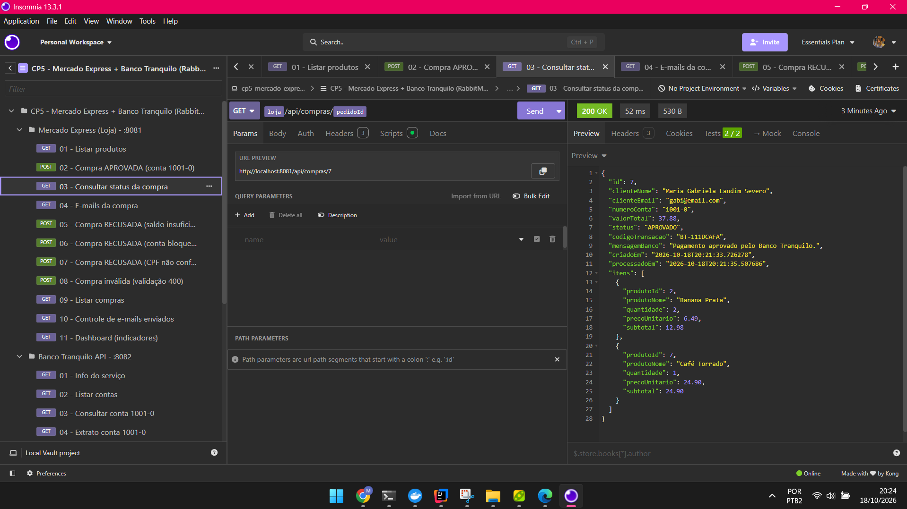

### 2) Dashboard do RabbitMQ (testes internos)

Em http://localhost:15672 (`guest`/`guest`):

1. **Exchanges** → veja `banco.tranquilo.pagamentos.exchange` e `mercado.express.pagamentos.exchange` e seus **bindings**.
2. **Queues** → acompanhe as taxas de *publish/deliver/ack* das filas durante uma compra.
3. **Teste manual de publicação:** abra *Exchanges → banco.tranquilo.pagamentos.exchange → Publish message*:
   - **Routing key:** `pagamento.solicitado`
   - **Properties:** `content_type` = `application/json`
   - **Payload:** o JSON de [`docs/exemplos/mensagem-rabbitmq-solicitacao.json`](docs/exemplos/mensagem-rabbitmq-solicitacao.json)
   - Clique em **Publish message** e veja nos logs do Banco Tranquilo a mensagem sendo consumida e a resposta publicada.
4. **Get messages:** pare o Banco Tranquilo, faça uma compra e, em *Queues → banco.tranquilo.pagamentos.request → Get messages*, veja a mensagem JSON aguardando na fila. Ao subir o banco de novo, ela é processada.
5. **DLQ:** publique um payload sem `pedidoId` (ex.: `{"valor": 10}`) e veja a mensagem cair em `banco.tranquilo.pagamentos.request.dlq`.

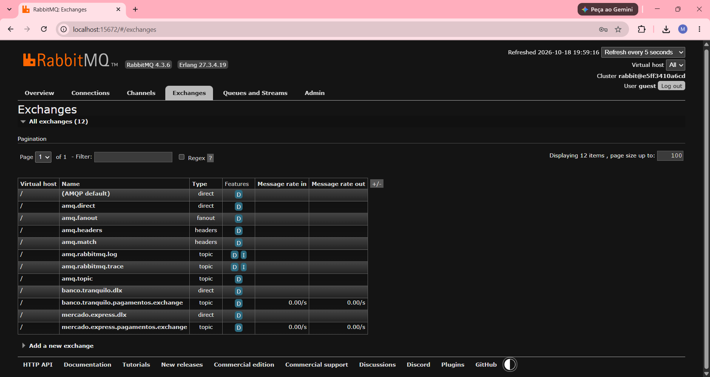
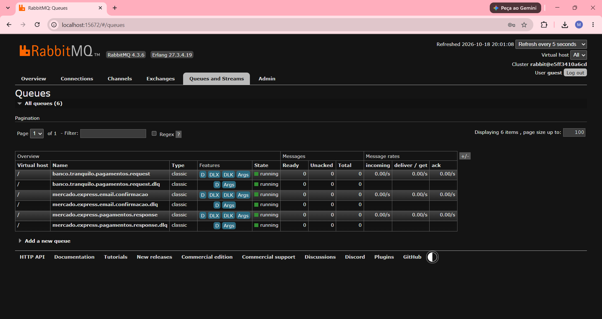
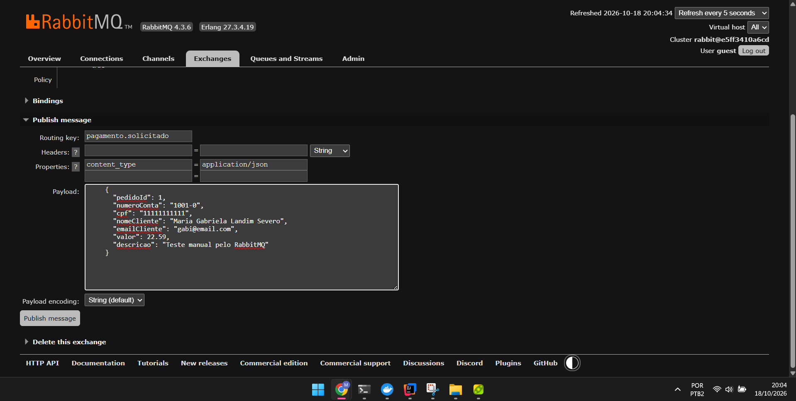

### 3) Script de teste

```bash
bash docs/teste-integracao.sh
```

Cria uma compra aprovada e uma recusada via API, espera o processamento e mostra o resultado, os e-mails e as transações do banco.

---

## ✉️ Envio de e-mail

Quando o Banco Tranquilo **aprova** o pagamento, a Loja publica `email.confirmacao`; o `EmailListener` consome, o `EmailService` monta o HTML (template Thymeleaf `email/confirmacao-pagamento.html`) e envia via `JavaMailSender`. **Todo envio, com sucesso ou falha, é salvo na tabela `TDS_MQ_TB_Email`.**

- **Local (padrão):** Mailpit - abra http://localhost:8025 para ver o e-mail recebido.
- **E-mail real (Gmail):** gere uma *senha de app* na conta Google e rode a Loja com:

```bash
MAIL_HOST=smtp.gmail.com MAIL_PORT=587 MAIL_SMTP_AUTH=true MAIL_STARTTLS=true \
MAIL_USERNAME=seuemail@gmail.com MAIL_PASSWORD=sua-senha-de-app MAIL_FROM=seuemail@gmail.com \
./mvnw spring-boot:run
```

---

## 📁 Estrutura do projeto

```
mercado-express-mensageria/
├── docker-compose.yml                  # PostgreSQL + RabbitMQ + Mailpit (+ apps com --profile apps)
├── docker/postgres/01-create-databases.sql
├── postman/CP5-MercadoExpress-BancoTranquilo.postman_collection.json
├── docs/ (exemplos JSON, testes.http, teste-integracao.sh, img/)
├── mercado-express-loja/               # Microsserviço da Loja (porta 8081)
│   └── src/main/java/br/com/fiap/mercadoexpress/loja/
│       ├── config/       RabbitConfig, RabbitNames, DataInitializer
│       ├── messaging/    MensageriaProducer, PagamentoResponseListener, EmailListener,
│       │                 EventosTransacionais, mensagens (records)
│       ├── services/     PedidoService, EmailService, DashboardService, Carrinho
│       ├── controllers/  LojaWebController, DashboardController, api/CompraApiController
│       ├── models/       Produto, Pedido, ItemPedido, EmailEnviado (+ enums)
│       ├── repositories/ dtos/ exceptions/
│   └── src/main/resources/templates/   loja/, pedidos/, email/, fragments.html
└── banco-tranquilo-api/                # Microsserviço do Banco (porta 8082)
    └── src/main/java/br/com/fiap/bancotranquilo/
        ├── config/       RabbitConfig, RabbitNames, DataInitializer
        ├── messaging/    PagamentoRequestListener, PagamentoResponsePublisher, mensagens
        ├── services/     PagamentoService, ContaService
        ├── controllers/  BancoApiController
        ├── models/       Conta, Transacao, StatusTransacao
        └── repositories/ dtos/ exceptions/
```

---

## 👤 Autores

| Nome | RM |
|---|---|
| Maria Gabriela Landim Severo | 565146 |
| Samara Porto Souza | 559072 |

**Turma:** 2TDS · **IDE utilizada:** IntelliJ IDEA

---

## 📄 Licença

Projeto acadêmico desenvolvido para fins educacionais na disciplina de Java Advanced - FIAP.